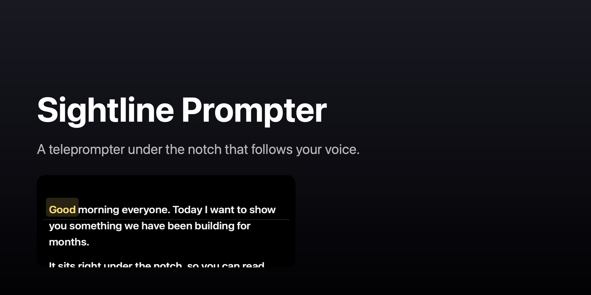
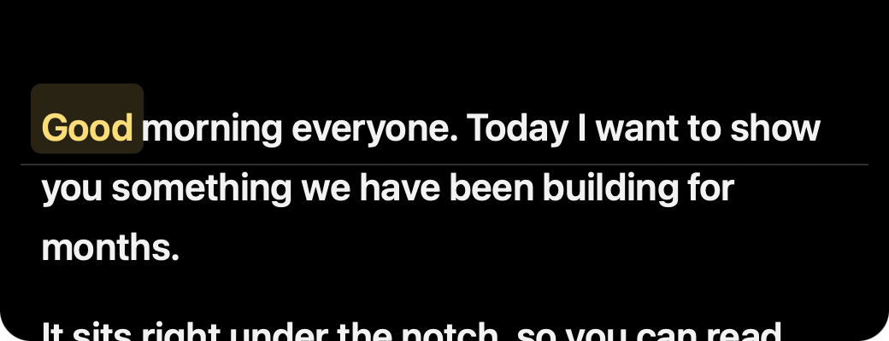
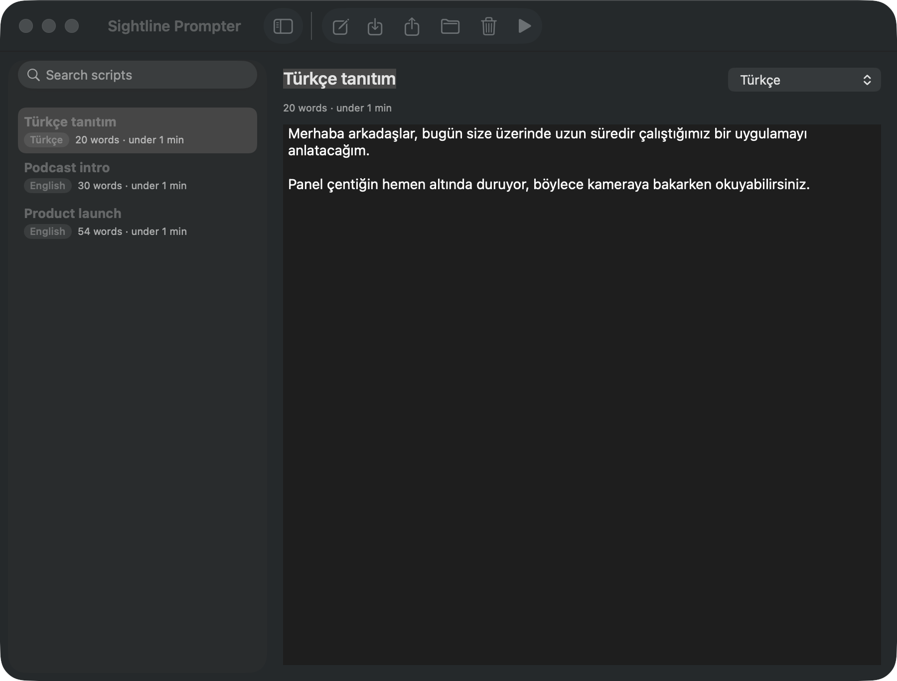
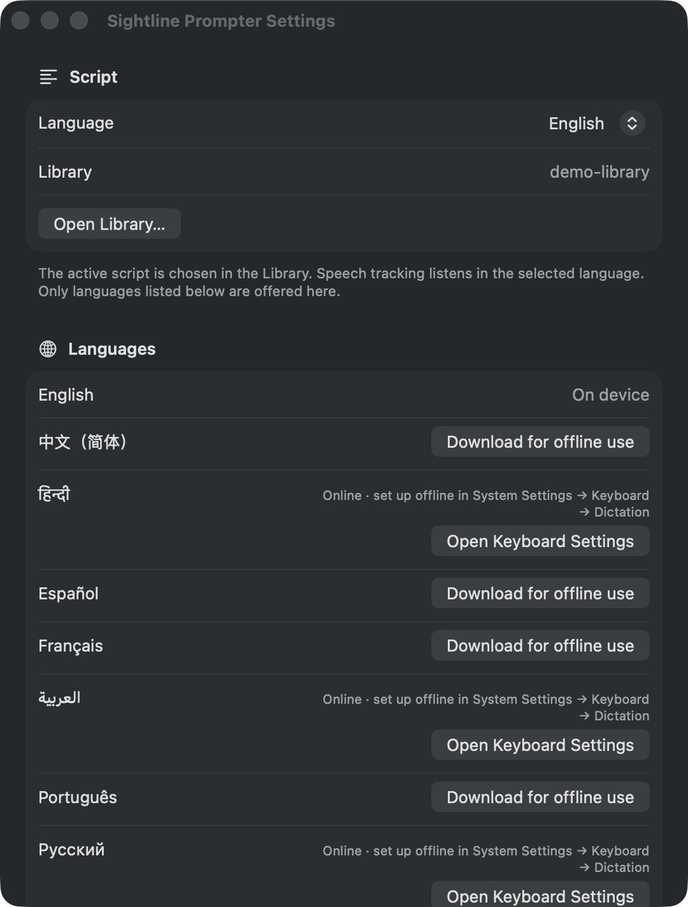

# Sightline Prompter

A teleprompter that lives under the MacBook notch. It follows your voice, so the script moves with you, and it can be driven by mouse, trackpad or a PlayStation controller. An iPhone version records video while you read.

Keeping the text right under the camera lets you read while looking at the lens.



## Features

- **Voice following.** Speech recognition finds the word you are reading and keeps it on the reading line. It only matches words that are on screen, so it does not jump to unrelated parts of the script.
- **31 languages and regional variants:** every language Apple offers for one-click offline download (English, German, Italian, Spanish, French, Portuguese, Japanese, Korean, Mandarin and Cantonese, and more), plus Turkish. Chinese, Japanese and Cantonese are segmented into words automatically.
- **Pace.** Words per minute and time left, measured from your actual reading speed. Pauses are not counted.
- **Gamepad.** DualSense (PlayStation 5) controllers over Bluetooth or USB: analog stick for scrolling, D-pad for speed, paragraph jumps, tracking toggle. The stick response curve and max speed are adjustable.
- **Light bar.** The DualSense light shows tracking and scroll state.
- **Script library.** Scripts are saved as one file each, in the iCloud container shared by the Mac and iPhone apps (iCloud Drive > Sightline Prompter), so a script added or edited on one shows up on the other. Without iCloud they stay in Documents.
- **Delivery cues.** Anything written between double square brackets, like `[[pause, smile]]` or `[[look at the camera]]`, is a direction to you, not text to say. The prompter shows it in its own small italic blue style, on its own line when the cue stands alone and inline when it sits inside a sentence. Speech following skips it, and it does not count in the word total or the pace estimate. The same on iPhone and Mac.
- **Import.** Plain text, Markdown, RTF, HTML, Word (.doc, .docx), OpenDocument (.odt) and PDF. Drop a file on the Library window, or open it with the app.
- **Window.** Width, height and horizontal position are set in Settings. Hover over the panel for controls. The window joins every Space, including full-screen apps, and can be hidden from screen sharing.

## iPhone app

The iPhone app is a recording teleprompter. Pick a script, and the app opens the front camera with a short prompter band right under the Dynamic Island, so you read while looking near the lens.

- **Script picker.** The home screen lists your scripts. Tap one to start. Create, import, search, edit, duplicate and delete scripts there, using the same import formats as the Mac app.
- **Prompter band.** 3 lines in portrait, 5 lines in landscape, next to the camera. The live preview is scaled down into the rest of the screen, with the record button and camera controls.
- **Adjustable area.** Width and height of the band are set per orientation in Settings. A narrow, short band keeps eye movement small on the recording.
- **Voice following.** The same word-by-word following as on the Mac, fed by the camera's microphone, so it keeps working while you record. It follows spoken numbers, resumes after notifications, and picks up from the words on screen when you scroll to another part.
- **Video.** 16:9 or 4:3, resolution and frame rate, codec (HEVC, H.264, ProRes), color, HDR, stabilization, torch, exposure and focus locks. Each launch starts with the front camera, 16:9, 4K, 30 fps. Recordings are saved to Photos.
- **Languages.** The same languages as the Mac app. Turkish needs the iOS Dictation model for on-device recognition, otherwise audio goes to Apple's servers.

Requires iOS 17 or later and the Xcode project in `iOS/`, see Build from source. There is no App Store release yet.

## Requirements

- macOS 14 (Sonoma) or later. The control bar uses Liquid Glass on macOS 26 and a HUD material on earlier systems.
- A Mac with a notch works best. Other Macs get the panel at the top of the screen.

## Installation

1. Download `SightlinePrompter-1.0.0.zip` from the [latest release](../../releases/latest).
2. Unzip it and drag **Sightline Prompter** into `/Applications`.
3. The app is ad-hoc signed and not notarized, so macOS blocks the first launch. Remove the quarantine flag once:

   ```sh
   xattr -dr com.apple.quarantine "/Applications/Sightline Prompter.app"
   ```

4. Open the app. macOS asks for microphone and speech recognition access the first time you turn on speech tracking.

## Speech recognition

Speech is recognized by Apple's Speech framework. When a language's offline model is on the Mac, recognition runs offline. Otherwise the audio goes to Apple's servers, and the status line says so.

Settings lists every language with its state:

| Language | State | How to get it |
|---|---|---|
| Every language Apple offers for one-click download (31 locales with regional variants) | **Download for offline use** | Click the button in Settings. The offline model downloads from Apple. |
| Turkish | On device when macOS has its Dictation model, otherwise online | No download button: Apple does not offer a one-click download for it |

Arabic, Hindi, Russian and Indonesian are not offered: Apple has no one-click offline download for them. Scripts already saved in those languages still open.

Chinese, Japanese and Cantonese word matching works on segments from the language tokenizer, so accuracy is lower than for spaced languages.

## Screenshots

| Panel under the notch | Script library | Settings |
|---|---|---|
|  |  |  |

## Controls

| Input | Action |
|---|---|
| Click the text | Play / pause |
| Mouse wheel or trackpad | Scroll (manual scrolling moves the reading position) |
| Hover over the panel | Show the control bar |
| Left stick | Scroll speed follows stick deflection |
| D-pad up / down | Auto-scroll speed |
| X | Play / pause |
| Square | Restart |
| L1 / R1 | Previous / next paragraph |
| Triangle | Speech tracking on / off |
| Circle | Show / hide the panel |

## Privacy

- Speech audio is passed to Apple's Speech framework only. The app has no network code of its own and no telemetry.
- Scripts stay on your Mac or in your iCloud Drive folder.

## Build from source

Requires Xcode 26 or later.
```sh
git clone https://github.com/berkbayri/sightline-prompter.git
cd sightline-prompter
swift build -c release
swift test
./macOS/build.sh   # builds, installs to /Applications and launches
```

The iPhone app uses [XcodeGen](https://github.com/yonaskolb/XcodeGen) to create its Xcode project from `iOS/project.yml`:

```sh
brew install xcodegen
cd iOS
xcodegen generate
open SightlinePrompter.xcodeproj   # choose your team under Signing, then run on an iPhone
```

## Known limits

- The app is not notarized. Gatekeeper needs the one-time step above.
- DualSense light bar support is written against the GameController API but has not been checked on every firmware.
- Recognition accuracy depends on the language model and on how closely the spoken text follows the script.

## Contributing

Bug reports and pull requests are welcome. Keep changes focused, and run `swift test` before opening a pull request.

## FAQ

**Is there a teleprompter that follows my voice on a Mac?**
Yes, this one. It listens while you read and keeps the word you are on at the reading line, without jumping to other parts of the script.

**Does it need a MacBook with a notch?**
No. On a Mac without a notch the panel sits at the top center of the screen.

**Does it work offline?**
Yes, for languages whose speech model is on the device. The status line tells you when recognition goes to Apple's servers.

**Which languages?**
Every language Apple offers for one-click offline download, with regional variants (for example English (United States), German (Germany), Japanese, Mandarin Chinese (Simplified), Cantonese), plus Turkish. Settings lists each one with its download state.

**Can I read a script from a file?**
Yes. Plain text, Markdown, RTF, HTML, Word, OpenDocument and PDF can be imported into the Library.

**Can I use a PlayStation controller?**
Yes, a DualSense over Bluetooth or USB. The stick, D-pad and buttons are mapped above, and the light bar shows the state.

## License

GPL-3.0. See [LICENSE](LICENSE).
