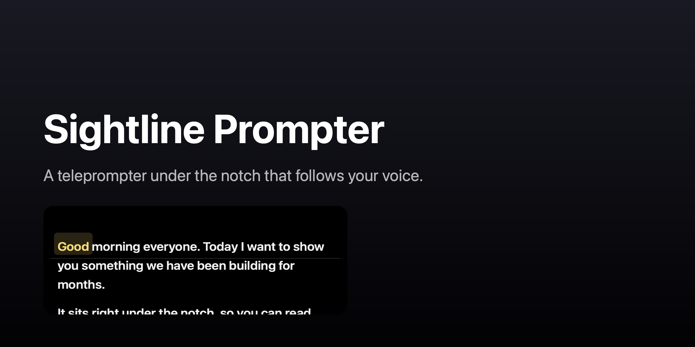

# Sightline Prompter

A teleprompter that lives under the MacBook notch. It follows your voice, so the script moves with you, and it can be driven by mouse, trackpad or a PlayStation controller.

Keeping the text right under the camera lets you read while looking at the lens.



## Features

- **Voice following.** Speech recognition finds the word you are reading and keeps it on the reading line. It only matches words that are on screen, so it does not jump to unrelated parts of the script.
- **Eleven languages:** English, Mandarin Chinese, Hindi, Spanish, French, Arabic, Portuguese, Russian, Indonesian, Japanese and Turkish. Chinese and Japanese are segmented into words automatically. Arabic is laid out right to left.
- **Pace.** Words per minute and time left, measured from your actual reading speed. Pauses are not counted.
- **Gamepad.** DualSense (PlayStation 5) controllers over Bluetooth or USB: analog stick for scrolling, D-pad for speed, paragraph jumps, tracking toggle. The stick response curve and max speed are adjustable.
- **Light bar.** The DualSense light shows tracking and scroll state.
- **Script library.** Scripts are saved as one file each, in iCloud Drive if it is available, otherwise in Documents. Switch the folder in Settings.
- **Import.** Plain text, Markdown, RTF, HTML, Word (.doc, .docx), OpenDocument (.odt) and PDF. Drop a file on the Library window, or open it with the app.
- **Window.** Width, height and horizontal position are set in Settings. Hover over the panel for controls. The window joins every Space, including full-screen apps, and can be hidden from screen sharing.

## Requirements

- macOS 14 (Sonoma) or later. The control bar uses Liquid Glass on macOS 26 and a HUD material on earlier systems.
- A Mac with a notch works best. Other Macs get the panel at the top of the screen.

## Installation

1. Download `SightlinePrompter-1.0.0.zip` from the [latest release](../../releases/latest).
2. Unzip it and drag **Sightline Prompter** into `/Applications`.
3. The app is ad-hoc signed and not notarized, so macOS blocks the first launch. Remove the quarantine flag once:

   ```sh
   xattr -dr com.apple.quarantine "/Applications/Sightline Prompter.app"
   ```

4. Open the app. macOS asks for microphone and speech recognition access the first time you turn on speech tracking.

## Speech recognition

Speech is recognized by Apple's Speech framework. It runs on the device when the language model is installed, and otherwise the audio is sent to Apple's servers. Check the current state in the app: the status line says when the server is used.

| Language | Speech tracking | Recognition |
|---|---|---|
| English | Yes | On device when installed |
| Turkish | Yes | On device when installed |
| Mandarin Chinese, Hindi, Spanish, French, Arabic, Portuguese, Russian, Indonesian, Japanese | Yes | Apple's servers, unless the model is installed |

Chinese and Japanese word matching works on segments from the language tokenizer, so accuracy is lower than for spaced languages.

## Controls

| Input | Action |
|---|---|
| Click the text | Play / pause |
| Mouse wheel or trackpad | Scroll (manual scrolling moves the reading position) |
| Hover over the panel | Show the control bar |
| Left stick | Scroll speed follows stick deflection |
| D-pad up / down | Auto-scroll speed |
| X | Play / pause |
| Square | Restart |
| L1 / R1 | Previous / next paragraph |
| Triangle | Speech tracking on / off |
| Circle | Show / hide the panel |

## Privacy

- Speech audio is passed to Apple's Speech framework only. The app has no network code of its own and no telemetry.
- Scripts stay on your Mac or in your iCloud Drive folder.

## Build from source

Requires Xcode 26 or later.

```sh
git clone https://github.com/berkbayri/sightline-prompter.git
cd sightline-prompter
swift build -c release
swift test
./build.sh   # builds, installs to /Applications and launches
```

## Known limits

- The app is not notarized. Gatekeeper needs the one-time step above.
- DualSense light bar support is written against the GameController API but has not been checked on every firmware.
- Recognition accuracy depends on the language model and on how closely the spoken text follows the script.

## Contributing

Bug reports and pull requests are welcome. Keep changes focused, and run `swift test` before opening a pull request.

## License

GPL-3.0. See [LICENSE](LICENSE).
