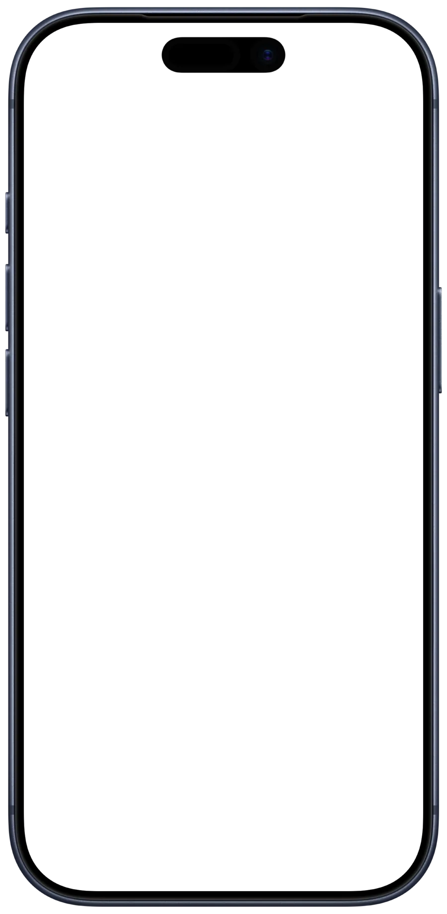

# Device composites (Apple Product Bezels + real app screens)

Bezels: Apple Product Bezels (Apple Design Resources), iPhone 17 Pro "Deep Blue" and MacBook Pro M5 14-inch "Space Black", used unmodified. Screens: iOS Simulator captures of the Debug app (`-ScreenshotScene recording`, status bar 9:41, full battery/Wi-Fi/signal) and the English Mac notch panel render (cursor mid-sentence, read words dimmed, centred highlight) on a fictional desktop with a dim call window, no Dock. PNG sources (full resolution) are in `../src/devices/`. Provenance is embedded in every file (`impeccable embed-prompt --read`).

All WebP are 2x display size. Percent values below are relative to the image's own width/height, so they hold at any rendered size.

| File | px | Slot |
|---|---|---|
| `iphone-prompter-portrait.webp` | 900x1840 | Hero devices section, iPhone (render at 300-450 CSS px wide) |
| `macbook-panel.webp` | 2000x1316 | Hero devices section, Mac (render at 700-1000 CSS px wide) |
| `iphone-prompter-landscape.webp` | 1840x900 | Crop section, landscape iPhone (crop guide + thirds are real app UI) |
| `iphone-screenonly-portrait.webp` | 900x1840 | Autosize sticky section, base layer: bezel + photo + status bar, no app UI, so live HTML text can sit in the screen |
| `iphone-frame-portrait.webp` / `iphone-frame-landscape.webp` | 900x1840 / 1840x900 | Bezel only, transparent screen. Put any HTML/video/img under it (z-order: content below, frame above) |

## Screen rects (% of image)

| Image | left | top | width | height | corner radius of the screen |
|---|---|---|---|---|---|
| iPhone portrait (all `iphone-*-portrait`) | 5.333% | 2.500% | 89.333% | 95.000% | 207/1206 of width = `17.2% / 7.9%` (elliptical `border-radius`) |
| iPhone landscape (all `iphone-*-landscape`) | 2.500% | 5.333% | 95.000% | 89.333% | `7.9% / 17.2%` |
| MacBook (`macbook-panel`) | 10.829% | 11.339% | 78.342% | 77.323% | top corners ~40/3024 of width = `1.32% / 2.04%`, bottom corners square |

Native source pixels: iPhone screen is 1206x2622 (portrait) in a 1350x2760 bezel at offset (72, 69). Landscape is 2622x1206 in 2760x1350 at (69, 72). Mac screen is 3024x1964 in 3860x2540 at (418, 288).

Dynamic Island (drawn by the bezel): keep live text below 8% of the screen height (the status bar occupies the top ~5.6%). Mac notch (drawn by the bezel): x 43.7%-56.3% of the screen width, top 3.8% of the screen height; the real panel capture sits flush under it.

## Autosize sticky section: HTML text inside the iPhone screen

Use the frame-only file on top and your own content under it:

```html
<div class="dev" style="position:relative;aspect-ratio:1350/2760">
  <div class="screen" style="position:absolute;left:5.333%;top:2.5%;width:89.333%;height:95%;
       border-radius:17.2% / 7.9%;overflow:hidden;z-index:1"> <!-- photo/video + live prompter text here; bleed 1-2px past the rect -->
  </div>
  
</div>
```

or put the text over `iphone-screenonly-portrait.webp` in the same rect (the photo is already in the screen). Text is the app's own UI here (allowed). Size the live text from the screen rect, not the image (the captured text is about 9% of the screen width per character-line height; match it by eye against `iphone-prompter-portrait.webp`). Ink page colour is `#07080C`; Deep Blue sits well on it.

## Apple marketing rules to honour (Apple Product Images guidelines)

- Use the bezel as is: no crop, tilt, flip, animation, CSS shadow/glow/reflection/filter/opacity, no recolour, nothing obscuring it. Show the whole device.
- Promotional copy goes beside the device, never on top of it. Overlays inside the screen must be the app's own UI.
- Minimum device height 200 px onscreen. Keep relative scale if two devices share a view.
- Screen content must look like the running app, full status bar (done; landscape has none because iOS hides it), no blank screen, fictional data. The Mac desktop uses the app icon in the Dock and no Apple logo; keep it that way.
- Never use the standalone Apple logo. Add a credit line wherever legal info is: "iPhone and MacBook Pro are trademarks of Apple Inc." (use the symbols only in US copy). Do not start a URL with an Apple trademark.
- Use only devices and colours Apple provides; do not claim an Apple association.

Other finishes (17 Pro / 17 Pro Max, Silver and Cosmic Orange, Silver MacBook) are not shipped; originals stay outside the repo in `/tmp/claude-502/bezel-png/`. The composite scripts used are `/tmp/claude-502/dev/comp.sh` and `build-mac-screen.sh` (not committed).
